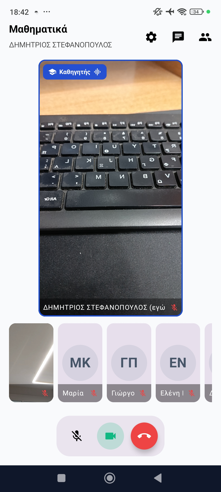
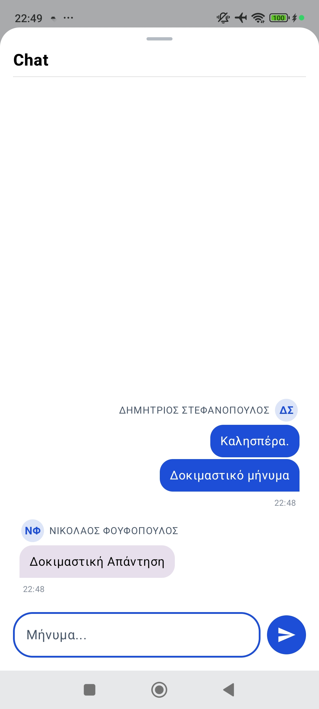
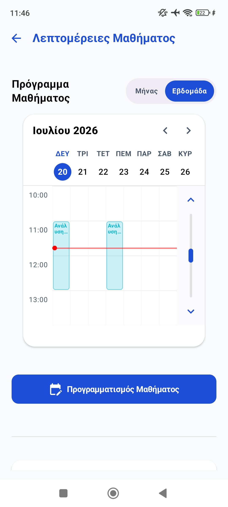
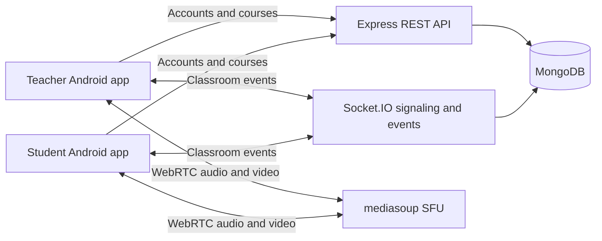
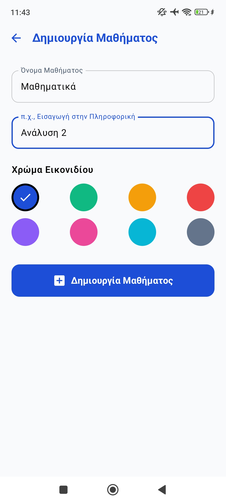
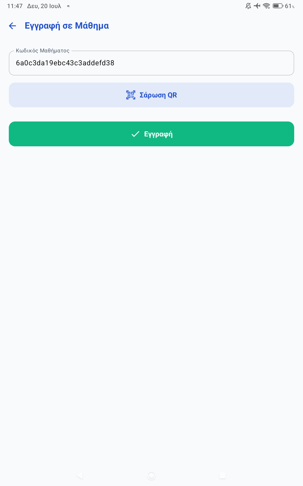
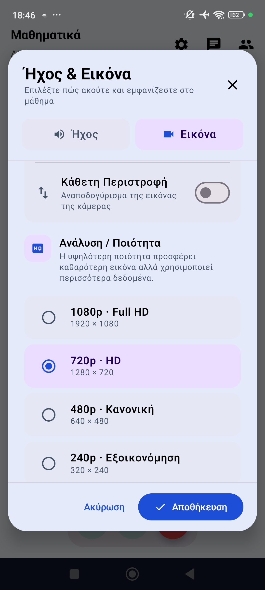

<p align="center">
  
</p>

# ClassWave

**An Android virtual classroom with live audio and video, real-time chat and course management.**

ClassWave is my undergraduate thesis project at the Department of Informatics, University of Piraeus, supervised by Professor Efthimios Alepis. I developed the Android application in Kotlin and Jetpack Compose, together with a Node.js backend for course management, signaling and media routing.

The application brings teachers and students into a shared classroom across Android phones and tablets. WebRTC carries the audio and video through a mediasoup Selective Forwarding Unit (SFU), while Socket.IO delivers signaling and classroom events.

[Watch the application demo](https://github.com/nickfouf/ClassWave-Portfolio/releases/download/showcase-v1/ClassWave_Demo.mp4) · [Setup guide](docs/SETUP.md)

## Application preview

<p align="center">
  
  
  
</p>

The screenshots show the application on Android devices. Names and conversations belong to the demonstration scenario. The demo combines two device sessions with four simulated participants to illustrate the classroom interface and interaction.

## Features

- Teacher and student accounts, with JWT-protected REST endpoints.
- Course creation and enrollment through a course identifier or QR code.
- Scheduled and recurring lessons with monthly and weekly views.
- Live audio and video, microphone and camera controls, participant pinning and raised hands.
- Classroom chat and synchronized lesson-state updates.
- Camera preview, camera selection and outgoing video-quality settings.
- Android notifications and an ongoing-call foreground service.
- Greek and English interfaces, with light and dark themes.

## Architecture



| Component | Technologies | Responsibilities |
| --- | --- | --- |
| Android application | Kotlin, Jetpack Compose, Retrofit, mediasoup client | Navigation, course screens, call UI, device media and notifications |
| REST API | Node.js, Express, Mongoose, JWT | Accounts, courses and stored classroom information |
| Real-time service | Socket.IO | Signaling, chat and classroom-state events |
| Media server | mediasoup, WebRTC | SFU routing of participant audio and video |
| Persistence | MongoDB | Users, courses and messages |

## Source layout

```text
class-wave-android-app/   Android application and Gradle wrapper
class-wave-backend/       REST API, signaling, SFU configuration and tests
dummy-participants/      Optional demonstration participant generator
docs/images/             Selected application screenshots
docs/SETUP.md            Local development instructions
```

## Run locally

Use Node.js 22 or newer for the backend. Node.js 24 LTS is the version selected in `.nvmrc`. The Android project targets SDK 36 and supports Android API 24 and above.

```sh
cd class-wave-backend
cp .env.example .env
# Set JWT_SECRET in .env to a long, randomly generated value.
npm ci
npm start
```

Start MongoDB before the backend. Open `class-wave-android-app` in Android Studio and configure the backend host in `local.properties`. The backend and media server addresses must both be reachable from the devices.

The [setup guide](docs/SETUP.md) includes Windows commands, network requirements and the optional demonstration tool.

## Verification

The repository includes six backend tests covering classroom chat and its lifecycle, plus Android local tests for call-state and outgoing-video behavior.

```sh
cd class-wave-backend
npm ci
npm test
```

```sh
cd class-wave-android-app
./gradlew testDebugUnitTest assembleDebug
```

On Windows, use `gradlew.bat` and an ASCII-only project directory. See [verification notes](docs/VERIFICATION.md) for the checks performed on this public snapshot and their scope.

## Development status

ClassWave was built and demonstrated as an academic prototype. The recorded sessions establish its implemented features. The thesis discusses network connectivity, authorization and a proposed evaluation protocol.

Before an internet-facing deployment, the project needs consistent Socket.IO authentication and per-event course authorization, HTTPS/WSS, restricted CORS, and a TURN deployment for networks that require relay connectivity. Password recovery currently directs users to an administrator.

The thesis also identifies the need for controlled load, QoS/QoE and educational-effectiveness measurements. These remain future evaluation work.

## More screens

<p align="center">
  
  
  
</p>

## Application demo

- [Application demo, MP4](https://github.com/nickfouf/ClassWave-Portfolio/releases/download/showcase-v1/ClassWave_Demo.mp4). A silent excerpt of the final presentation video, focused on the application workflow.

**Author** · Nikolaos Foufopoulos

**University** · University of Piraeus, Department of Informatics

**Supervisor** · Professor Efthimios Alepis
